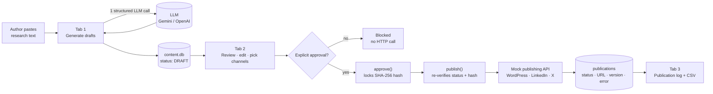

# AI Content Generation & Automated Publishing Agent

**Research update in → three channel-ready drafts out → human approval → automated publishing.**

A self-contained Python + Streamlit application that takes a raw research write-up
(project description, project update, findings summary, or event announcement) and
turns it into **three genuinely different drafts** — a LinkedIn post, a stakeholder
newsletter, and a website news article — with a **single LLM call**.

Nothing goes out without a person. Drafts pass through a **mandatory, code-enforced
approval gate**; once approved, the agent publishes them over **real HTTP requests**
to a local mock WordPress / LinkedIn / X API and records every attempt with status,
URL, timestamp, error message, and content version.

> All sample content is fictional. No real social or WordPress credentials are used
> or required. Only `.env.example` is committed; a real `.env` stays git-ignored.

---

## Highlights

| | |
|---|---|
| **One input → three formats** | One structured-JSON LLM call returns all three drafts, each with its own tone and length |
| **Facts stay facts** | The prompt forbids invented numbers, dates, and names; output is validated before it can be saved |
| **Approval is not optional** | Publishing is blocked by workflow status **and** a SHA-256 content hash — editing after approval forces re-approval |
| **Real integration, safely** | Actual `HTTP POST` calls with JSON bodies, timeouts, and per-channel error capture against a running mock API |
| **Idempotent publishing** | Republishing unchanged content is a no-op; changed and re-approved content publishes as a new version |
| **Auditable** | Every attempt lands in a `publications` table, visible in the UI and exportable as CSV |
| **Tested** | 8 tests cover the gate, hash tampering, re-approval, idempotency, and a live round-trip against the mock API |

**Stack:** Python 3.9+ · Streamlit · SQLite · Gemini (default) or OpenAI · FastAPI mocks · pytest

---

## How it works



1. **Generate** — the source text and an optional title go into a single
   `chat_json()` call with a strict schema. The response is validated; missing
   fields raise a clear error instead of being filled in.
2. **Review** — the three drafts are stored in SQLite as `DRAFT`. A reviewer can
   edit each version inline and select which channels to publish to.
3. **Approve** — approval stamps `approved_at`, the selected channels, and a
   SHA-256 hash of the exact drafts being approved.
4. **Publish** — `publish()` re-checks the gate, then POSTs each approved draft to
   its mock endpoint. Results are shown per channel and written to the log.
5. **Audit** — the publication log can be filtered and exported as CSV.

---

## Features

### Content generation
- Title (optional) + raw research text, with four fictional samples built in
  under `sample_content/`.
- **One** LLM call produces:
  - `linkedin_post` — professional and engaging, ~1500 characters max, 0–2 hashtags,
    outcomes-focused, organizational voice (no "I'm excited to share…");
  - `newsletter_summary` — 2–3 short stakeholder paragraphs;
  - `website_announcement` — structured article: headline, 2–4 paragraphs, and an
    optional bullet list.
- Numbers, dates, and names must be copied verbatim — no rounding or reformatting.
- Malformed or incomplete model output surfaces as a readable error, never a
  half-filled draft.

### Content library
- SQLite `content.db`, created automatically on first run.
- One row per input with the three drafts and a full status lifecycle:
  `DRAFT → PENDING_APPROVAL → APPROVED → PUBLISHED`, plus `REJECTED` and `OUTDATED`.
- Filter rows by status and creation date.

### Human approval gate
- Side-by-side review with inline editing per channel.
- Actions: **Approve & Publish**, **Save edits only**, **Submit for review**,
  **Reject**, **Re-publish**.
- Any edit after approval resets the row to `OUTDATED`, and it cannot publish again
  until re-approved.
- The gate is enforced twice — once by status, once by hashing the current drafts
  and comparing them to the approved snapshot. Tampering with the stored status
  does not bypass it (fail closed).

### Automated publishing
- Real `HTTP POST`s with JSON payloads, request timeouts, and `try/except`
  handling against a locally running FastAPI mock.
- Returned URLs are stored per channel.
- Idempotent: a channel already published with the same approved hash is skipped
  with no duplicate row and no HTTP call. After an edit and re-approval, the new
  hash publishes again as a new version.
- Per-channel success/failure is shown immediately in the UI.

### Publication log
- Every attempt with status, returned URL, timestamp, version (content-hash
  prefix), and error message.
- Filter by status and date; export to CSV from the UI or from a script.

---

## Project structure

```
ai-content-publishing-agent/
├── app_content.py                   # Streamlit UI (3 tabs)
├── agents/
│   └── content.py                   # generate / approve / publish / log (plain functions)
├── services/
│   ├── db_content.py                # all SQL — content.db, auto-created
│   └── llm.py                       # LLM wrapper: Gemini default, OpenAI via .env
├── mock/
│   ├── wordpress.py                 # mock WordPress REST API  (POST /wordpress/posts)
│   └── social.py                    # mock LinkedIn and X APIs (POST /social/linkedin, /x)
├── scripts/
│   ├── run_mock_api.py              # starts the mock HTTP service on :8001
│   ├── generate_samples_content.py  # writes the four fictional inputs
│   └── export_outputs_content.py    # writes outputs/ deliverables
├── tests/
│   └── test_publish_gate.py         # approval-gate tests + live mock round-trip
├── sample_content/                  # fictional research inputs
├── outputs/                         # generated deliverables
├── docs/architecture_content.md     # architecture, diagrams, design rationale
├── requirements.txt
├── requirements-dev.txt
├── .env.example
└── README.md
```

The `_content` suffixes in filenames are leftovers from the folder's original
working name and can be safely dropped later (`app.py`, `db.py`, `architecture.md`);
imports and docs would need to be updated together.

---

## Quick start

```bash
python3 -m venv .venv
source .venv/bin/activate
pip install -r requirements.txt
cp .env.example .env
# edit .env and add a Gemini API key (free: https://aistudio.google.com/apikey)
```

Run the mock publishing API and the app in two terminals:

```bash
python scripts/run_mock_api.py     # terminal 1 — mock API on http://127.0.0.1:8001
streamlit run app_content.py       # terminal 2 — the app
```

The sidebar can also **auto-start** the mock API, so `streamlit run app_content.py`
alone is enough for a one-command demo.

Open <http://localhost:8501>, load a sample from Tab 1, and generate.

### Optional commands

```bash
python scripts/generate_samples_content.py   # (re)create the fictional sample inputs
pytest -q                                    # 8 tests (one skips if the mock API is down)
python scripts/export_outputs_content.py     # refresh outputs/ deliverables
```

---

## Configuration

Both `.env` keys and their defaults are read in `services/llm.py` and
`services/db_content.py`:

| Variable | Default | Purpose |
|---|---|---|
| `LLM_PROVIDER` | `gemini` | `gemini` or `openai` |
| `GEMINI_API_KEY` | — | required when using Gemini |
| `GEMINI_MODEL` | `gemini-3.8-flash` | any model your key can access |
| `OPENAI_API_KEY` | — | required when using OpenAI |
| `OPENAI_MODEL` | `gpt-4o-mini` | any chat model that supports JSON mode |
| `MOCK_API_BASE` | `http://127.0.0.1:8001` | where the app sends publish requests |
| `MOCK_API_PORT` | `8001` | port the mock server binds to |
| `CONTENT_DB_PATH` | `content.db` | SQLite file path (relative to the repo root) |

> If generation fails with a model-not-found error, check that `GEMINI_MODEL` matches
> a model currently available to your API key — model names change over time.

---

## Try it (~3 minutes)

1. **Tab 1 — Draft content.** Load the *findings summary* sample (it contains
   `47 percent`, `2.1 → 2.8 percent`, `214 observations`, and dates). Click
   **Generate three drafts**. Compare the three outputs: a punchy post, a sober
   stakeholder summary, and a structured news article — with every number
   unchanged. Save to the content library.
2. **Tab 2 — Approvals & publishing.** Select the new row. Edit a draft to see the
   hash change, pick your channels, then **Approve & Publish**. You get one result
   per channel with a mock URL; open the `http://127.0.0.1:8001/blog/<slug>` link to
   see the "published" article served by the mock site.
3. **Watch the gate work.** Edit an approved or published row and click
   **Save edits only** — status becomes `OUTDATED`. **Re-publish** is refused.
   Re-approve, publish again, and the log shows a new version.
4. **Tab 3 — Publication log.** Review `SUCCEEDED` / `FAILED` rows, versions, and
   timestamps. Stop the mock API, try to publish, and watch a genuine failure get
   logged. Export the CSV.

---

## The approval gate in detail

All gate logic lives in `agents/content.py`; `tests/test_publish_gate.py` is the
executable specification.

1. **Only `approve()` sets `APPROVED`.** It writes the timestamp, the selected
   channels, and `approved_content_hash` — SHA-256 over the canonical JSON of the
   three current drafts.
2. **`publish()` calls `assert_approval_gate()` first** and raises `ApprovalError`
   (recording nothing, calling nothing) unless:
   - status is `APPROVED`, or `PUBLISHED` with unchanged content;
   - an approval timestamp and hash exist;
   - the hash of the current drafts still equals the approved hash.
3. **Edits after approval reset to `OUTDATED`**, so either the status check or the
   hash check blocks publication until a fresh approval is recorded.
4. **Idempotency:** if a channel already succeeded with the same approved hash,
   the run reports `ALREADY_PUBLISHED` and sends nothing.
5. **Fail closed:** no channels selected → approval refused; unknown channel →
   refused; empty draft → logged `FAILED`, never a silent success.

This is deliberately redundant. Status alone is mutable state; the hash makes the
gate verifiable even if the database row is edited by hand.

---

## Publishing targets

| Draft | Mock endpoint | Production equivalent |
|---|---|---|
| `website_announcement` | `POST /wordpress/posts` | WordPress REST API `POST /wp-json/wp/v2/posts` (application-password auth) |
| `linkedin_post` | `POST /social/linkedin` | LinkedIn API v2 `POST /v2/ugcPosts` (OAuth2) |
| `newsletter_summary` | `POST /social/x` | X API v2 `POST /2/tweets`; a real newsletter would use an email provider such as Mailchimp |

The mocks are one-for-one stand-ins: same JSON request/response shape, same
failure modes (including the LinkedIn ~3000-character limit returning HTTP 422).
Switching to production means changing base URLs, adding auth, and pointing the
targets at the real services — the gate, logging, and UI stay untouched.

Each mock module's docstring documents the exact production call it mirrors.

---

## Data model

Both tables are created automatically by `services/db_content.py`, which holds all
SQL in one place.

**`content`** — one row per input:

```
id, title, source_text,
linkedin_post, newsletter_summary, website_announcement,
status, approved_at, approved_content_hash, selected_channels, created_at
```

**`publications`** — one row per publish *attempt* per channel:

```
id, content_id, channel, status, published_url, published_at,
error_message, content_hash
```

`content_hash` doubles as the version marker shown in the log.

---

## Tests

```bash
pytest -q
```

`tests/test_publish_gate.py` covers:

| Test | Proves |
|---|---|
| `test_publish_is_blocked_before_approval` | no HTTP call and no log row for an unapproved draft |
| `test_publish_is_blocked_for_pending_and_rejected_rows` | intermediate states cannot publish |
| `test_approve_requires_channels` | approval requires at least one channel |
| `test_approved_row_publishes_and_logs` | approval → publish → URLs and status recorded |
| `test_edit_after_approval_requires_reapproval` | edit → `OUTDATED` → blocked → re-approve → new version |
| `test_hash_mismatch_blocks_publish_even_if_status_says_approved` | status tampering does not bypass the gate |
| `test_republish_unchanged_content_is_a_noop` | no duplicate calls or log rows |
| `test_mock_api_live_roundtrip` | a real HTTP round-trip to a running mock (skipped when offline) |

Tests use a temporary database and a stubbed HTTP function, so they need no
network and no API keys.

---

## Sample outputs (`outputs/`)

- `publication_log.csv` — a real export of publish attempts, including a genuine
  `FAILED` round captured while the mock API was briefly offline plus the
  successful retry.
- `linkedin_sample.md`, `newsletter_sample.md`, `website_sample.md` — the three
  drafts from a real run against the "numbers must not be altered" sample, with
  every number preserved verbatim.

Regenerate with `python scripts/export_outputs_content.py`; samples are written
from the newest complete content row.

---

## Design decisions

- **Plain Python, no orchestration framework.** The interesting parts — schema
  validation, the gate, HTTP error handling — are visible in one module instead of
  hidden in a workflow tool.
- **A mock API instead of live credentials.** The assessment rules forbid real
  social credentials, and no production site exists. A running FastAPI service
  still exercises the real thing that matters: payloads, timeouts, HTTP errors,
  retries, and idempotency.
- **SQLite with a single SQL module.** Zero setup, and swapping the storage layer
  later touches one file.
- **Hash-based approval, not just a status flag.** A status column can be edited;
  a content fingerprint cannot be forged by accident.

---

## Limitations & next steps

**Known limitations**
- Mock endpoints have no real reach: returned URLs are fake and posts live in the
  server's memory until it restarts.
- Text only — no image or attachment uploads.
- A single user acts as both author and approver; no roles or audit identities.
- Publishing happens immediately; there is no scheduling.
- The newsletter draft is published through the mock X endpoint so that every
  channel demonstrates a real HTTP round-trip.

**Next steps, in priority order**
1. Swap in real WordPress (application passwords) and LinkedIn (`ugcPosts`)
   integrations behind the same interface, with credentials from the environment.
2. Separate author and approver roles with an immutable audit trail.
3. Scheduled publishing and a "correct a published article" workflow.
4. Image generation/selection for the website and LinkedIn.
5. Pull reader metrics (views, likes, opens) back into the publications table.

---

## Feature → code map

| Capability | Where |
|---|---|
| Content input UI and sample loader | `app_content.py` (Tab 1), `sample_content/` |
| One LLM call → three validated drafts | `agents/content.py` (`generate_drafts`), `services/llm.py` |
| LLM and JSON failure handling | `services/llm.py` (`chat_json`, `_parse_json`), UI error banners |
| Content rows, statuses, filters | `services/db_content.py`, `app_content.py` (Tab 2) |
| Review, inline editing, channel selection | `app_content.py` (Tab 2) |
| Approve / save / reject / submit actions | `app_content.py` → `agents/content.py` |
| Edit-after-approval → `OUTDATED` → re-approve | `agents/content.py` (`save_edits`, `assert_approval_gate`) |
| Hash verification and fail-closed publishing | `agents/content.py` (`content_hash`, `assert_approval_gate`) |
| Real HTTP publishing | `agents/content.py` (`publish`, `_post_json`), `mock/*.py` |
| Publication records and CSV export | `services/db_content.py`, `app_content.py` (Tab 3), `scripts/export_outputs_content.py` |
| Mock API as a running service | `scripts/run_mock_api.py`, `mock/wordpress.py`, `mock/social.py` |
| Architecture and rationale | `docs/architecture_content.md` |
